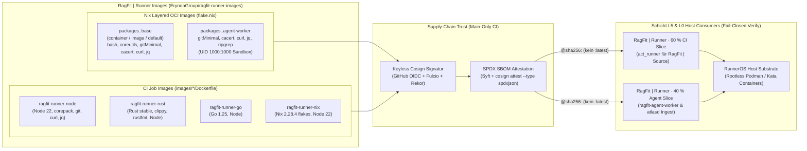

# RagFit | Runner Images (`ragfit-runner-images`)

**Reproducible, Keyless-Cosign-signed OCI Job & Agent Container Image Factory for `RagFit | Runner` (Gitea Actions CI/CD & NATS JetStream Agent Sandboxes).**

| Feld | Wert |
|---|---|
| **Status** | `active` (RA0 Stamp, Allowlist Boundary-Guard, Keyless CI Publishing & Nix OCI Layer Build) |
| **Tier** | `tier-2` |
| **Layer** | **Schicht L5 — Orchestration, Multi-Agents & Execution** (RagFit v4.0 7-Schichten-Gesamtarchitektur `L0`–`L6`) |
| **Lizenz** | Apache-2.0 ([LICENSE](./LICENSE) · [NOTICE](./NOTICE)) |
| **Rolle** | Reproducible OCI Image Factory für klassische CI-Jobs (`node`, `rust`, `go`, `nix`) sowie leichtgewichtige Nix-OCI-Sandbox-Images (`base`, `agent-worker`) |
| **Container Build** | `nix build .#container` / `just image` (`pkgs.dockerTools.buildLayeredImage` · zusätzlich `nix build .#agent-worker`) |
| **Agenten-Doktrin** | [`erynoa.md`](./erynoa.md) · [`AGENTS.md`](./AGENTS.md) · [`docs/ARCHITECTURE.md`](./docs/ARCHITECTURE.md) |

> [!IMPORTANT]
> **Architektonische Einordnung (`W8`-Auflösung):**  
> **`RagFit | Runner Images`** (`ErynoaGroup/ragfit-runner-images`) gehört zu **Schicht L5 (Orchestration, Multi-Agents & Execution)** der 7-schichtigen (`L0`–`L6`) Plattform-Dienstfamilie **`RagFit | *`** und liefert die Keyless-Cosign-signierten Laufzeit-Container für `RagFit | Runner`. Die hier gebauten Container enthalten keinerlei Geschäftslogik, Geheimnisse oder interne Topologiedaten und sind unter `Apache-2.0` öffentlich prüfbar.

---

## Quickstart

```bash
# 1. Reproduzierbare Nix-Entwicklungsumgebung starten (just, git, shellcheck, gitleaks, hadolint, cosign, jq)
nix develop

# 2. Vollständige Repo-Gesundheitsprüfung (Stamp, Allowlist Boundary-Guard, ShellCheck, Unit-Tests)
just doctor

# 3. Schnelles lokales CI-Gate vor jedem Commit / Pull Request
just ci-quick

# 4. Leichtgewichtiges Nix-OCI-Basis-Image bauen (.#container / .#base)
just image
# oder direkt via Nix:
nix build .#container

# 5. Spezialisiertes Nix-OCI-Sandbox-Image für autonome Agenten & Graph-Ingest bauen (.#agent-worker)
just build-agent-worker
# oder direkt via Nix:
nix build .#agent-worker
```

---

<!-- ERYNOA-MODEL:BEGIN -->
## Model

> Systemskizze (**SE-04** C4-lite) für **`RagFit | Runner Images`** als Schicht-4-Image-Fabrik.  
> Vertiefung: [`docs/ARCHITECTURE.md`](./docs/ARCHITECTURE.md) · Index: [`docs/README.md`](./docs/README.md) · Agenten: [`erynoa.md`](./erynoa.md).



### Bereitgestellte Image-Profile

| Image / Flake-Output | Bauart | Inhalt & Einsatzzweck |
|---|---|---|
| `packages.<sys>.base` (`container`, `image`, `default`) | Nix `dockerTools.buildLayeredImage` | Minimales Rootless-OCI-Basis-Image (`bashInteractive`, `coreutils`, `gitMinimal`, `cacert`, `curl`, `jq`, UID `1000:1000`) |
| `packages.<sys>.agent-worker` | Nix `dockerTools.buildLayeredImage` | Leichtgewichtiges Sandbox-Image für autonome Agenten-Läufe (`ragfit-agent`) und Graph-Ingest (`atlasd`) mit `gitMinimal`, `cacert`, `curl`, `jq`, `ripgrep` (UID `1000:1000`) |
| `ghcr.io/erynoagroup/ragfit-runner-node` | `images/node/Dockerfile` | Node 22, corepack, git, curl, jq (Basis per `@sha256:` gepinnt) |
| `ghcr.io/erynoagroup/ragfit-runner-rust` | `images/rust/Dockerfile` | Rust stable, clippy, rustfmt, Build-Tools, Node |
| `ghcr.io/erynoagroup/ragfit-runner-go` | `images/go/Dockerfile` | Go 1.25, Node |
| `ghcr.io/erynoagroup/ragfit-runner-nix` | `images/nix/Dockerfile` | Nix mit aktivierten Flakes, Node 22 |
<!-- ERYNOA-MODEL:END -->

---

## Tags & Keyless Verification (Fail-Closed)

Jedes veröffentlichte GHCR-Image erhält sein Versions-Tag (z. B. `22`, `1.25`) sowie `sha-<commit>`. **Es gibt niemals ein `:latest`-Tag; Konsumenten pinnen ausschließlich per `@sha256:<digest>`.**

Alle Images werden in GitHub Actions (`.github/workflows/images.yml`) **nur auf `refs/heads/main`** keyless mit [cosign](https://github.com/sigstore/cosign) (GitHub OIDC, öffentliches Rekor-Transparenzlog) signiert und tragen eine SPDX-SBOM-Attestation:

```sh
ID=https://github.com/ErynoaGroup/ragfit-runner-images/.github/workflows/images.yml@refs/heads/main
ISSUER=https://token.actions.githubusercontent.com

cosign verify --certificate-identity "$ID" --certificate-oidc-issuer "$ISSUER" \
  ghcr.io/erynoagroup/ragfit-runner-node@sha256:<digest>

cosign verify-attestation --type spdxjson \
  --certificate-identity "$ID" --certificate-oidc-issuer "$ISSUER" \
  ghcr.io/erynoagroup/ragfit-runner-node@sha256:<digest>
```

Pull Requests, Tags und manuelle Dispatches von anderen Branches bauen die Images nur zu Prüfzwecken, **ohne** Push und **ohne** Signatur.

## `flake.lock` & Public Boundary-Guard

- **`flake.lock`:** Wird in CI über den manuellen Workflow `flake-lock.yml` auf einem GitHub-hosted Runner aktualisiert (`ci/flake-lock-<run id>`).
- **Allowlist Boundary-Guard:** Da dieses Repository öffentlich ist, erzwingt [`scripts/boundary-guard.sh`](./scripts/boundary-guard.sh) über [`boundary-guard.conf`](./boundary-guard.conf) eine strikte Datei-Allowlist sowie das Verbot privater IP-/Tailnet-Adressen, E-Mail-Adressen, Mentions, lokaler Pfade und Geheimnisse.

---

## More

| Dokument | Beschreibung |
|---|---|
| [`erynoa.md`](./erynoa.md) | Kanonische Agenten-Doktrin, Planner, Invarianten (`I-1`–`I-4`) & Verbote (`F-1`–`F-4`) |
| [`docs/README.md`](./docs/README.md) | Vollständiger Dokumentations-Index (`Erynoa Docs v1`) |
| [`docs/ARCHITECTURE.md`](./docs/ARCHITECTURE.md) | Tiefgehende Schicht-4-Architektur (OCI Image Factory, Cosign OIDC Supply-Chain, Digest-Pinning) |
| [`docs/work/ROADMAP.md`](./docs/work/ROADMAP.md) | Arbeits- und Meilenstein-Fahrplan (`RA0`, `RN-C1`) |
| [`docs/work/RN-C1-images-contract.md`](./docs/work/RN-C1-images-contract.md) | Übergabevertrag (`RN-C1`) an `RagFit \| Runner` |
| [`LICENSE`](./LICENSE) · [`NOTICE`](./NOTICE) | Apache License 2.0 & Lizenzhinweise |
