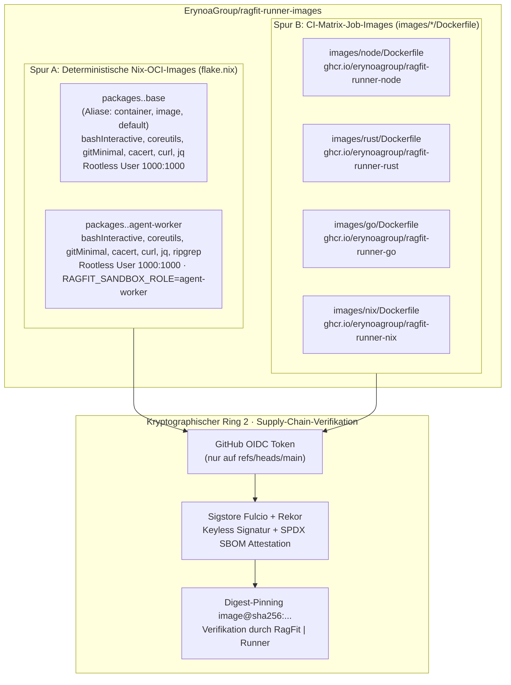

# Architektur — RagFit | Runner Images (`ErynoaGroup/ragfit-runner-images`)

> **Status:** Normative Architektur der OCI-Image-Fabrik (RagFit v4.0, Stand 2026-10-16)  
> **Schicht:** Schicht `L5` — Orchestration, Multi-Agents & Execution (Reproducible OCI Image Factory)  
> **Plattform-Scope (`W8`):** Souveräne Agent-First-Plattform-Dienstfamilie (`RagFit | *`, 7-Schichten-Gesamtarchitektur `L0`–`L6`)  
> **Lizenz & Sichtbarkeit:** Öffentlich (`Apache-2.0`, siehe [`LICENSE`](../LICENSE) und [`NOTICE`](../NOTICE))

---

## 1. Rolle in der RagFit v4.0 7-Schichten-Gesamtarchitektur (`L0`–`L6`)

In der siebenstufigen Gesamtarchitektur (`L0`–`L6`) der Plattform-Dienstfamilie **`RagFit | *`** (gemäß `W8`) nimmt **`RagFit | Runner Images`** innerhalb von **Schicht L5 (Orchestration, Multi-Agents & Execution)** die Rolle der **entkoppelten, öffentlich prüfbaren OCI-Image-Fabrik** ein:

| Schicht | Systemeinheiten | Beziehung zu `ragfit-runner-images` |
|---|---|---|
| **`L6` — Presentation, BFF & Observability** | `RagFit \| Console`, `RagFit \| Monitor`, `RagFit \| Docs`, `rk` CLI | Zeigt Build-/Attestations-Evidenz und Runner-Telemetrie an |
| **`L5` — Orchestration, Multi-Agents & Execution** | `RagFit \| Ops`, `RagFit \| Agent`, `RagFit \| Runner`, **`RagFit \| Runner Images`** *(dieses Repo)* | **Produziert und signiert alle Job- und Agenten-Container-Images**, die `RagFit \| Runner` im 60/40-Dual-Use-Modell ($\mathbf{I_{13}}$) ausführt |
| **`L4` — Knowledge, Memory & Ingest** | `RagFit \| Memory`, Single-Writer `atlasd` ($\mathbf{I_7}$) | Nutzt das `agent-worker`-Sandbox-Image für isolierte Code-Graph- und Wissens-Ingest-Jobs |
| **`L3` — Operative Domain Cores** | `RagFit \| Source`, `RagFit \| Plan` | Workflows in `RagFit \| Source` referenzieren die Aufgaben-Labels, die auf diese Images abbilden |
| **`L2` — Event, Messaging, Coordination & SDK** | `RagFit \| Bus` (NATS JetStream), `RagFit \| SDK` | Transportiert `ragfit-agent-tasks` und `ragfit-knowledge-requests` an Worker-Sandboxes |
| **`L1` — Identity, Trust & Cryptography** | `RagFit \| Auth`, Kryptographische Ringe 1–4 | Ring 2 (Artefakt- & Supply-Chain-Integrität, $\mathbf{I_{14}}$) verifiziert die Keyless-Cosign-Signaturen und SPDX-SBOMs vor jedem Container-Start |
| **`L0` — Declarative OS, Network & Storage Substrate** | `.nixos-devstack`, `.nixos-runnerstack` (`RunnerOS`), `.nixos-lifecyclestack`, `.nixos-common` | `RunnerOS` führt die verifizierten `@sha256:`-Digests in Rootless Podman bzw. Kata MicroVMs aus |

### Warum ein eigenes öffentliches Repository?

1. **Verzicht auf langlebige Signaturschlüssel (Keyless OIDC):** Durch die Auslagerung der unkritischen Standard-Toolchain-Images in ein öffentliches `Apache-2.0`-Repository kann GitHub Actions OIDC mit Sigstore Fulcio und dem öffentlichen Rekor-Transparenzlog genutzt werden. Es existiert kein privater `cosign.key`, der kompromittiert oder rotiert werden müsste.
2. **Kein Selbst-Bau auf Produktions-Runnern (Bootstrap-Isolation):** Runner-Hosts bauen niemals ihre eigenen Basis-Job-Images zur Laufzeit. Sie ziehen ausschließlich vorab gebaute, kryptographisch verifizierte `@sha256:`-Digests.
3. **Strikte Trennung von OS, Dienst und Images:**
   - **Host-OS (`RunnerOS`):** Besitzt Hardware, Kernel, `cgroups v2`-Slices (`60 %` CI / `40 %` Agent), Rootless Podman / Kata und Host-Secrets.
   - **`RagFit | Runner`:** Besitzt das NixOS-Dienstmodul, den `act_runner`-Daemon, den NATS-Worker und das Verify-Gate.
   - **`RagFit | Runner Images` *(dieses Repo)*:** Besitzt ausschließlich die deklarativen Image-Definitionen (`flake.nix`, `images/*/Dockerfile`), deren CI-Pipeline und den Allowlist-Boundary-Guard.

---

## 2. Zweigleisige OCI-Image-Architektur: Nix Layered Images & Sprach-Job-Images

### 2.1 Spur A: Leichtgewichtige Nix-OCI-Images (`flake.nix`)

Über `pkgs.dockerTools.buildLayeredImage` stellt `flake.nix` für `x86_64-linux` und `aarch64-linux` bit-reproduzierbare, minimale Rootless-Container bereit:

1. **`packages.<system>.base` (sowie `container`, `image`, `default`):**
   - Enthält ausschließlich `bashInteractive`, `coreutils`, `gitMinimal`, `cacert`, `curl` und `jq`.
   - Läuft als unprivilegierter User `1000:1000` mit Arbeitsverzeichnis `/work` und vorkonfiguriertem `SSL_CERT_FILE`.
   - Dient als universelles Minimal-Image für schnelle Gate-, Skript- und Verifikationsläufe (`nix build .#container` bzw. `just image`).
2. **`packages.<system>.agent-worker`:**
   - Erweitert das minimale Profil um `ripgrep` (`rg`) und setzt `RAGFIT_SANDBOX_ROLE=agent-worker`.
   - Konzipiert für die **40 %-Agenten-Kapazität (`ragfit-agent.slice`)** in `RagFit | Runner`:
     - Ausführung isolierter `ragfit-agent`-Läufe aus der NATS JetStream WorkQueue `ragfit-agent-tasks` (orchestriert durch `RagFit | Ops`).
     - Ausführung deterministischer Code-Graph- und Wissens-Ingest-Läufe (`atlasd`) aus der WorkQueue `ragfit-knowledge-requests`.

### 2.2 Spur B: Sprachspezifische CI-Job-Images (`images/*/Dockerfile`)

Für die **60 %-CI/CD-Kapazität (`ragfit-ci.slice`)** von `RagFit | Source` (Gitea Actions kompatible Workflows) werden vier aufgabenorientierte Images bereitgestellt, deren Basis-Images selbst strikt per `@sha256:`-Digest gepinnt sind:

- **`images/node/Dockerfile` (`ragfit-runner-node`):** Node 22 (`node:22-bookworm-slim` per Digest), `corepack`, `git`, `curl`, `jq`, `ca-certificates`.
- **`images/rust/Dockerfile` (`ragfit-runner-rust`):** Rust stable (`rust:1-slim-bookworm` per Digest), `clippy`, `rustfmt`, C-Toolchain, Node 22 (für GitHub/Gitea Action-Steps).
- **`images/go/Dockerfile` (`ragfit-runner-go`):** Go 1.25 (`golang:1.25-bookworm` per Digest), `git`, `curl`, `jq`, Node 22.
- **`images/nix/Dockerfile` (`ragfit-runner-nix`):** `nixos/nix:2.28.4` (per Digest) mit aktivierten `nix-command` und `flakes` sowie Node 22.

---

## 3. Kryptographische Supply-Chain-Kette & Digest-Pinning in `RagFit | Runner`

### 3.1 Main-Only Publishing-Invariante

In `.github/workflows/images.yml` ist das Veröffentlichen und Signieren durch eine doppelte Schranke geschützt:

1. Der Job `publish` läuft nur bei `github.ref == 'refs/heads/main'` und `github.event_name != 'pull_request'`.
2. Als allererster Schritt im `publish`-Job bricht ein expliziter Shell-Guard ab, falls `GITHUB_REF` nicht exakt `refs/heads/main` lautet.

### 3.2 Exakte Zertifikatsidentität beim Konsumenten (`RN-C1`)

Wenn `RagFit | Runner` (oder das Host-OS-Substrat) ein Image aus diesem Repository startet, akzeptiert das Verify-Gate **keine** Regex-Muster und **keine** Tags, sondern prüft exakt:

- **`--certificate-identity`:** `https://github.com/ErynoaGroup/ragfit-runner-images/.github/workflows/images.yml@refs/heads/main`
- **`--certificate-oidc-issuer`:** `https://token.actions.githubusercontent.com`
- **Attestations-Typ:** `--type spdxjson` (erzeugt mit `anchore/sbom-action` / `syft`)

Ein Image aus einem Fork, einem Feature-Branch, einem Tag-Trigger oder ohne gültige SPDX-SBOM-Attestation wird **fail-closed** abgewiesen, bevor ein Container-Prozess startet.

---

## 4. Öffentlicher Allowlist-Boundary-Guard (`boundary-guard.conf`)

Da `ErynoaGroup/ragfit-runner-images` öffentlich einsehbar ist, operiert [`scripts/boundary-guard.sh`](../scripts/boundary-guard.sh) hier im **Allowlist-Modus (`allow-path`)**:

- Jede getrackte Datei im Repository muss explizit durch eine `allow-path`-Regel in [`boundary-guard.conf`](../boundary-guard.conf) legitimiert sein (`images/*`, `.github/*`, `flake.nix`, `justfile`, `erynoa.md`, `AGENTS.md`, `CLAUDE.md`, `.claude/*`, `docs/README.md`, `docs/ARCHITECTURE.md`, `docs/decisions/*`, `docs/work/*`, `scripts/*`, `tests/*`).
- Gleichzeitig scannen die `deny-content`-Regeln den gesamten Git-Index bzw. Arbeitsbaum gegen Tailnet-Namen, private IPv4/IPv6-Bereiche, interne Domains, E-Mail-Adressen, Account-Mentions, lokale Dateisystempfade und Schlüsselmaterial.
